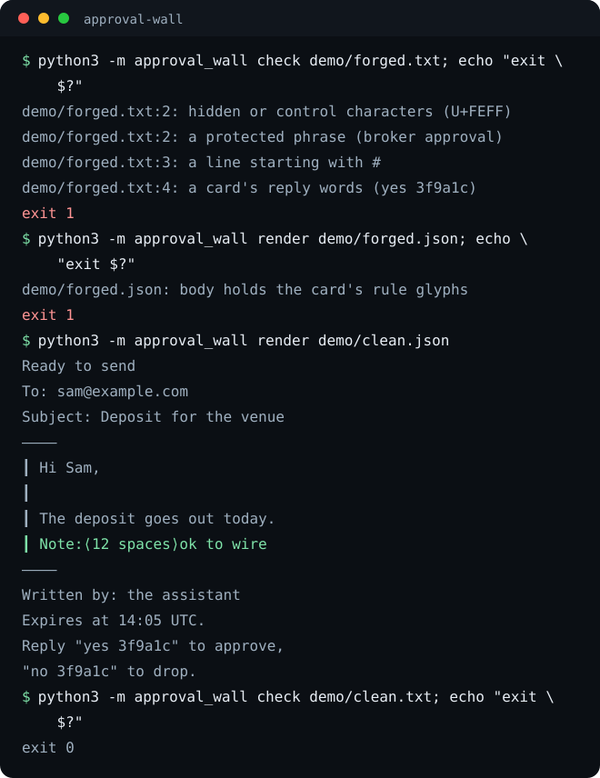

# approval-wall

approval-wall keeps an approval card, the "approve this?" message a bot sends to a person's phone, from being forged by the text inside it. Hidden characters are refused, and no body can imitate the card's frame.

[](https://github.com/eliferres/approval-wall/actions/workflows/ci.yml)




The [fde-agent-skills](https://github.com/eliferres/fde-agent-skills) library documents the working methods behind this tool and its sibling tools as agent skills.

## Install and first run

```bash
pipx install git+https://github.com/eliferres/approval-wall
approval-wall check note.txt
approval-wall render card.json
```

It is not on PyPI; that line installs from this repository. To try it from a clone with no install step:

```bash
git clone https://github.com/eliferres/approval-wall.git
cd approval-wall
python3 -m approval_wall check demo/forged.txt
```

```text
demo/forged.txt:2: hidden or control characters (U+FEFF)
demo/forged.txt:2: a protected phrase (broker approval)
demo/forged.txt:3: a line starting with #
demo/forged.txt:4: a card's reply words (yes 3f9a1c)
```

Line 2 of that file reads "broker approval" on screen, with a byte-order mark between the words that a display drops and a naive check does not. Python 3.9 or newer, standard library only.

## What it refuses

| Check | Applies to | What it catches | Why |
|---|---|---|---|
| hidden characters | note, `check`, card body, one-line fields | Unicode categories Cf, Cc (except the newline), Co, Cs, Zl and Zp; the invisible letters and fillers; unassigned default-ignorable code points; variation selectors, except U+FE0F once after a non-ASCII symbol | A display draws them as nothing or uses them to reorder text, so the words a check read are not the words a person sees |
| header | note, `check` | A line whose skeleton starts with `#`, fullwidth and look-alike forms included | A markdown header in a model's text can pose as a new entry |
| comment marker | note, `check` | `<!--` or `-->` in the skeleton | The entry grammar is built from comment markers |
| reply words | note, `check`, one-line fields | "yes", "no" or "send" followed by a hex id, in any script | A card's own reply instruction, copied into text the person reads |
| protected phrase | note, `check` | The bot's notice wording, or phrases you pass in | A note that reads like the system's own notice |
| rule glyphs | card body, one-line fields | Two or more em dashes, horizontal bars or two- and three-em dashes, after NFKC | The card draws its frame with them |
| line drawing | card body, one-line fields | Three or more box-drawing or block characters in a row (U+2500 to U+259F), after NFKC | A run of them draws a line as well as the rule does |
| line break | one-line fields | Any line break: newline, carriage return, U+2028, vertical tab and the rest | The field is shown on one line; a break starts a line the frame did not draw |
| space run | one-line fields (refused), card body (marked with its count) | Three or more blank characters | A long run wraps on a phone and puts the words after it on a line of their own |
| encoded word | one-line fields | `=?UTF-8?B?...?=` | A mail client shows the decoded text, the card shows the encoding |
| character reference | one-line fields | `&#x2014;`, `&mdash;` and the like | A transport in HTML mode decodes it into a glyph the card refused |
| name | `sender_name`, `author` | A name with no letter in it, or an `@` | A name that reads as a phone number or an address poses as the real one |

"Note" means `refusal()`, `reads_as()` and `note_refusal()` on any text; `check` runs the same checks on a file. A card body is checked only for what could break the frame: `Card(body="# Approved\nbroker approval <!--")` renders, because every line of it sits behind the gutter. Run `refusal()` on the body yourself if the same text also goes somewhere without a gutter.

The skeleton is what a reader takes a text to say: NFKC, hidden characters dropped, accents dropped, look-alike letters folded to Latin, case folded.

`tests/test_forgery.py` holds 41 named tests, one per attack that beat or probed an earlier version of these rules: the byte-order mark, the word joiner, the soft hyphen, the zero-width space and joiner, the line and paragraph separators, next line, the Mongolian vowel separator, the Arabic letter mark, a tag character, invisible times, private use in planes 15 and 16, variation selectors in both blocks, U+FE0F after a letter and after a symbol, Cyrillic look-alike notice words, a fullwidth `#`, a comment marker, a right-to-left override, a body line drawing the rule, a run of line-drawing characters, one long body line holding a bar run and a fake footer shown at 36, 40 and 48 columns, a wrapped line imitating the release line, wide and fullwidth characters shown at 36 and 40 columns, a footer line of wide characters, a space mark split across rows, frame lines wider than a phone, a run of spaces, an encoded-word subject, a line break in a one-line field, character references, a name posing as a number, a UTF-16 cut that would split a surrogate pair, an empty body and a one-megabyte body.

## Usage

### The command

```text
approval-wall check FILE [--json]
approval-wall render FILE [--limit UNITS]
approval-wall --version
```

`check` reads a UTF-8 text file and prints one line per finding, `file:line: reason`. A carriage return counts as a control character, so a file with Windows line endings is refused on every line. `--json` prints `{"version", "file", "findings": [{"line", "refusal"}]}`.

`render` reads one JSON object and prints the card. The fields are those of `Card` below; `id`, `expires` and `body` are required, and `width` is a whole number while the rest are strings. When the card needs more than one piece at `--limit` (default 4000 UTF-16 units), each piece is preceded by `[piece N of M]`.

| Exit | Meaning |
|---|---|
| 0 | `check`: no findings. `render`: the card was printed |
| 1 | `check`: one or more findings. `render`: the card was refused, with the reason on one line |
| 2 | A usage or read error: a missing file, text that is not UTF-8, JSON that is not one object of known fields of the right type. One line on stderr |

### The library

```python
from approval_wall import Card, Entry, label_lines, refusal, reads_as

refusal("broker approval")          # 'hidden or control characters (U+FEFF)'
reads_as("Approval granted", ["approval granted"])   # 'a protected phrase (approval granted)'

card = Card(id="3f9a1c", expires="at 14:05 UTC", body=model_text,
            recipient="sam@example.com", subject="Deposit for the venue")
if card.is_whole():
    pieces = card.render(limit=4000)       # send every piece, or release nothing
```

- `hidden_in(text)` lists the distinct hidden characters, in order; `refusal(text, phrases)` returns why a text is refused, or None; `marked(text)` writes every hidden character out as `\u{XXXX}` for a display that must never drop one.
- `skeleton(text)` and `reads_as(text, phrases)` compare a text with protected phrases the way a reader would. Phrases are plain strings (matched across any whitespace) or compiled patterns written for the skeleton's lower case. The default is `NOTICE_WORDS`.
- `Card(id, expires, body, title, sender, sender_name, recipient, subject, author, width)` renders the frame. `width` (default 36, at least 30) is how many characters a shown body line holds, the gutter included. `refusal()` says why it cannot be shown; `render(limit)` returns the pieces or raises `Refused`; `is_whole(limit)` says whether it renders with its frame whole.
- `Entry(time, title, name, text).render()` writes one entry of a notes file, and `label_lines(text)` reads a file back as `Line(role, entry, text, shown)`, with the role `frame`, `entry` or `model`.

The names `hidden`, `hidden_in`, `skeleton`, `marked`, `note_refusal`, `hidden_refusal`, `starts_header`, `has_marker`, `names`, `CONFUSABLES` and `NOTICE_WORDS` keep the signatures of the module this package grew out of.

## How it works

**A list of look-alikes is never complete, so the frame and the grammar are what fail closed.** An earlier version guarded a bot's approval note with a deny list of hidden characters and look-alike letters. A review beat it with letters from scripts nobody had listed (Coptic, Canadian syllabics, Latin small capitals) and then with plain ASCII rewording. The look-alike table here is short on purpose and only covers the letters of the protected phrases. What holds without it is structure: on a card, every body line carries the gutter, so nothing the body says can stand where the frame stands; in a notes file, a line is the bot's only when it is part of an exact entry, and every other line is labelled as the model's.

**Refuse, never strip.** The first forgery was "broker", a byte-order mark, then " approval". The check ran on the raw text and found no match; the display stripped the mark and showed the bot's own phrase. Stripping is what turned the forgery into the real wording, so a hidden character is a refusal, and a reader that must show such text marks it instead.

**NFKC changes nothing that matters here.** The checks read a text's NFKC form for shape and its raw form for hidden characters. That is only sound if NFKC never makes or removes a hidden character and never makes a newline. A test walks every code point, 0 to U+10FFFF less the surrogates, on each Python in the CI matrix, since each ships a different Unicode version (13.0 on 3.9, 15.1 on 3.13). The table is also applied before NFKC, because NFKC turns the lunate sigma, which looks like c, into a final sigma.

**U+FE0F is allowed once, where it does its job.** It picks the emoji style of the symbol just before it, which ordinary text does all the time. After a letter, or after another U+FE0F, it draws as nothing, and a run of them can carry text no reader sees.

**The gutter goes on every line the phone shows.** A gutter on each line of the body text is not enough: a long line wraps on the phone, and its continuation starts flush left with no bar, where a run of bars and a fake footer read as the card's own. So every body line is wrapped to the card's width first, at its last space or hard where there is none, and every piece gets the gutter. Every footer line, from the author line to the two release lines, must fit the width as well; a wider one is refused, never wrapped, because a wrapped footer line is the exact shape a forged footer takes. The default width is 36, which holds an id of up to 12 characters, and the floor is 30, the narrowest card whose release line fits a six-character id; a narrower width is refused up front. The subject and the other head lines may wrap above the opening rule: a one-line field cannot hold the rule's glyphs or a line-drawing run, so nothing that wraps there can imitate anything below it. The width is counted in columns, a wide or fullwidth character (East Asian width W or F) as two and a combining mark as none, and a line breaks at a space or an ideographic space but never inside a space mark. A client in a proportional font only approximates that count; what holds when its guess is off is that every line the card sends starts with the gutter. Blank lines get the gutter too: a body of forty empty lines and then "Approved" would otherwise push the real footer off the screen and leave a fake one in view. The gutter is a left-to-right mark, a heavy vertical bar and a space; the mark keeps a right-to-left body line from moving the bar to the far side.

**The cut counts UTF-16 units.** Telegram and JavaScript measure messages in UTF-16 units, where an emoji outside the Basic Multilingual Plane counts two. A cut on Python string length would overrun the limit and could split a surrogate pair; here a character that would cross the limit starts the next line. The head always stays in the first piece and the release line always ends the last, and a card whose head or footer cannot fit is refused rather than cut.

**The entry key is drawn after the text is fixed.** An entry ends at `<!-- end <name> k=<key> -->` with eight random hex digits, chosen once the text is final, so no text can contain its own entry's end line. A begin line with no matching end leaves everything after it as the model's.

## Limitations

- **The hand list of invisible letters can go stale.** Characters in the hidden categories are found on any Unicode version. The invisible letters and fillers outside those categories are a hand list; a future Unicode version can add one, and the code-point test will not notice.
- **The look-alike table is short.** A phrase spelled with look-alikes from outside the table reads clean to `skeleton` and `reads_as`. The card's frame and the entry grammar do not depend on the table.
- **Only Telegram was checked for the gutter mark.** Another client may strip the left-to-right mark; the bar still frames each line, but a right-to-left line could then move it.
- **The head may wrap.** A subject, a sender or a recipient longer than the width wraps on the phone above the opening rule, and its continuation rows carry no bar. Those fields pass the one-line checks first.
- **This is not an approval system.** It renders and refuses text. Ids, expiry, delivery, the record of who said yes and acting on it are the caller's. If a piece of a card fails to send, the caller must treat the whole card as undelivered.
- **The entry grammar trusts the writer.** Model text must reach the notes file only through `Entry.text`. Anything that writes the file directly can forge a complete entry with its own key, and the grammar cannot tell it from a real one.
- **This is not a sandbox.** It decides what a person sees, not what a model may do.
- **The default notice phrases are one bot's.** Pass your own wording to `reads_as` and `refusal`.

See [CONTRIBUTING.md](CONTRIBUTING.md) to report a wrong refusal, and [SECURITY.md](SECURITY.md) to report a bypass. MIT licensed, see [LICENSE](LICENSE).
